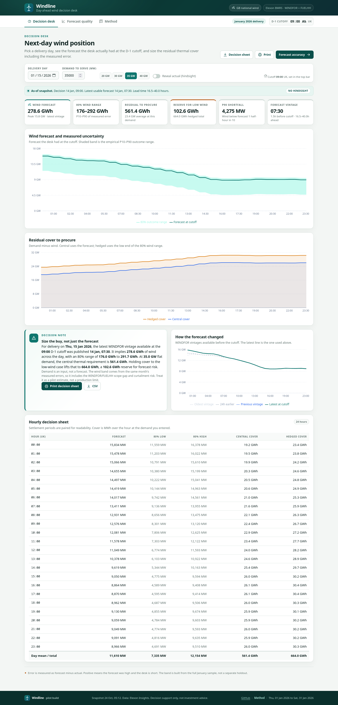
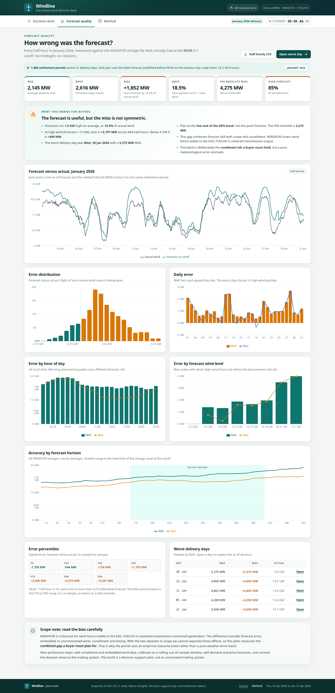

# Windline

**Day-ahead wind decision desk for a GB energy utility.**

Windline answers the question a buyer actually faces the morning before delivery: *the wind
forecast I am allowed to use says one thing — how much thermal cover should I buy, knowing how
wrong that forecast has been?*

It uses two public Elexon datasets only — **WINDFOR** (hourly wind forecast vintages) and
**FUELHH** (half-hourly metered wind output) — for a fixed **January 2026** delivery window.

[Repository](https://github.com/Manish881-hub/Energy-Evaluation) · [Method](docs/methodology.md) · [Demo script](docs/demo-script.md)

| Decision desk | Forecast quality |
| --- | --- |
|  |  |

## Why this exists

A day-ahead wind forecast is not a number to plan to. It is a number with a vintage, a lead time
and a measured miss. Most dashboards hide that behind a point forecast and a green line. Windline
makes the **as-of rule** and the **error distribution** first-class:

- **No hindsight.** For delivery day `D`, use the latest WINDFOR `publishTime` at or before
  **D-1 09:00 Europe/London**. Later vintages are ignored, even if they are more accurate.
- **Half-hour honesty.** WINDFOR is hourly. Each hour is applied to both settlement periods, then
  joined to FUELHH WIND actuals.
- **Directional risk.** Error is `forecast - actual`. Positive means over-forecast, so the desk is
  short relative to plan. The 80% band is asymmetric, built from the P10/P90 of signed error.
- **Decision, not just analysis.** Enter demand and the app sizes central and low-wind residual
  cover in MWh, with a printable/exportable decision sheet.

## What the January 2026 snapshot says

| Metric | Value |
| --- | ---: |
| Settled half-hours | 1,488 |
| Forecast rows / vintages | 11,873 / 264 |
| Mean actual wind | 11,581 MW |
| Mean forecast | 13,433 MW |
| MAE | 2,145 MW |
| RMSE | 2,616 MW |
| Bias | **+1,852 MW** (over-forecast) |
| WAPE | 18.5% |
| P90 absolute miss | 4,275 MW |
| Over-forecast half-hours | 84.9% |
| High-wind (≥15 GW) bias | +2,797 MW (644 half-hours) |
| Low-wind (<9 GW) bias | +409 MW (318 half-hours) |
| Worst day | 2026-01-28, MAE 5,375 MW |

The bias is **not** "just a bad forecast". WINDFOR is a forecast for wind farms visible to the ESO;
FUELHH is metered transmission-connected output. The gap includes forecast skill, unconstrained vs
delivered wind, curtailment and timing. Windline deliberately measures the **combined gap a buyer
must plan for** and says so in the product rather than hiding it in a correction factor. See
[docs/methodology.md](docs/methodology.md).

Example — delivery **15 Jan 2026**, 09:00 cutoff:

- Latest usable vintage: `2026-01-14T07:30:00Z` (1.5 h before cutoff, 16.5–40.0 h ahead).
- Wind: **278.6 GWh**, 80% range **176–292 GWh**.
- At 35 GW flat demand: central thermal cover **561.4 GWh**, low-wind cover **664.0 GWh** — a
  **102.6 GWh** reserve for forecast risk.

## Features

**Decision desk**
- Delivery-day picker (1–31 Jan 2026) and adjustable D-1 cutoff.
- As-of vintage card showing decision time, publish time and lead time.
- Six KPIs: wind forecast, 80% range, residual to procure, low-wind reserve, P90 shortfall, vintage.
- Forecast + uncertainty chart, residual cover chart, forecast-evolution chart.
- Hourly decision sheet with central/hedged cover, print view and CSV export.
- Demand presets (20/30/35/40 GW) and a manual input. Demand is an input, not a forecast.

**Forecast quality**
- MAE, RMSE, bias, WAPE, P90 absolute miss, over-forecast share.
- Forecast vs actual for the month, error histogram, daily error, by hour, by wind level, by horizon.
- Signed error percentile grid and worst delivery days (clickable).
- CSV export of every scored half-hour.

**Method**
- The four-step decision loop, metric definitions, band construction, scope caveat, AI disclosure and
  reproduction commands.

## Stack

- **Frontend:** React 18 + Vite, Recharts, plain CSS. No UI framework.
- **Backend:** FastAPI; the statistics live in a pure-standard-library Python module.
- **Data:** committed CSV snapshot; no API key, no live calls at runtime.
- **Tests:** pytest, 32 tests covering cutoff selection, hourly-to-half-hour alignment, metrics and
  API contracts.
- **Deploy:** one Docker image, or Vercel static build + Python function.

```
backend/app/analysis.py        as-of selection, alignment, metrics, day view, evolution
backend/app/main.py            FastAPI routes + SPA static serving
backend/scripts/ingest.py      Elexon snapshot fetcher (WINDFOR + FUELHH)
backend/scripts/make_demo_data.py  synthetic data for offline development
backend/tests/                 pytest suite
backend/data/                  committed January 2026 snapshot
frontend/src/                  React app (DecisionDesk, ForecastQuality, Method)
api/index.py                   Vercel serverless entrypoint
```

## Run locally

### Docker (single container)

```bash
docker compose up --build
# http://localhost:8000
```

If port 8000 is already in use:

```bash
PORT=8010 docker compose up --build
# http://localhost:8010
```

### Two processes

```bash
# 1. API
python3 -m venv .venv && source .venv/bin/activate
pip install -r requirements-dev.txt
uvicorn app.main:app --app-dir backend --reload --port 8000

# 2. UI (second terminal)
cd frontend
npm ci
npm run dev
# http://localhost:5173
```

If port 8000 is busy, run the API on 8010 and start Vite with:

```bash
VITE_API_TARGET=http://localhost:8010 npm run dev
```

### Tests

```bash
cd backend && python3 -m pytest -q
# 32 passed
```

### Re-ingest the snapshot

No API key is needed. Elexon public endpoints, January 2026 delivery window:

```bash
python3 backend/scripts/ingest.py --start 2026-01-01 --end 2026-01-31
```

This rewrites `backend/data/actuals.csv`, `forecasts.csv` and `meta.json`. The committed snapshot is
the reproducible input for every number in the app.

## API

| Route | Purpose |
| --- | --- |
| `GET /api/health` | Liveness |
| `GET /api/meta` | Window, counts, sources, provenance |
| `GET /api/day?day=2026-01-15&cutoff=09:00` | As-of decision, half-hour points, band, KPIs |
| `GET /api/accuracy?cutoff=09:00` | Summary, quantiles, histogram, breakdowns, worst days |
| `GET /api/horizon` | Accuracy by lead time |
| `GET /api/evolution?day=2026-01-15&cutoff=09:00` | Vintages available before the cutoff |
| `GET /api/export.csv?cutoff=09:00` | Every scored half-hour as CSV |

`cutoff` is `HH:MM` on the previous calendar day, Europe/London. `day` is the delivery date.

## Deploy

### Docker

```bash
docker build -t windline .
docker run --rm -p 8000:8000 windline
```

The image builds the SPA in a Node stage, then serves it and the API from Python 3.12 with Uvicorn.

### Vercel

`vercel.json` builds `frontend/` to static output and exposes `api/index.py` as a Python 3.12
function, with `backend/**` included. Import the repo in Vercel, or:

```bash
npx vercel deploy            # logged-in account
npx vercel deploy --temporary  # claimable temporary URL, no login
```

## Limits and next steps

- **In-sample band.** Error percentiles are measured on the same month they describe. One month is a
  small sample. A production system would calibrate on a rolling out-of-sample window.
- **Scope gap.** WINDFOR vs FUELHH includes curtailment and embedded/unconstrained wind effects. The
  app states this rather than applying an unexplained bias correction.
- **Demand is flat.** 35 GW default; no demand forecast, no price data, no portfolio shape.
- **National wind.** The utility's own contracted position and basis risk are out of scope.
- **No execution.** The decision sheet is a support tool; it does not place trades.

Next: add curtailment and embedded-wind data, add demand/price forecasts, calibrate out-of-sample,
connect the decision sheet to trade capture, and add authentication.

## AI disclosure

This build was produced with **opencode** running **DeepSeek V4.1 Flash**, using Matt Pocock's
engineering skills for TDD, codebase design and review. The assistant wrote code and tests; the
human set the brief, chose the 09:00 D-1 rule, rejected a bias-correction shortcut, and reviewed
the domain caveats. All metrics are computed by the committed Python analysis module from the
committed snapshot — no number is hand-entered into the UI. The tests and ingest script are the
audit trail.

## Author

Manish Bhaktisagar · [GitHub](https://github.com/Manish881-hub) · 2026
